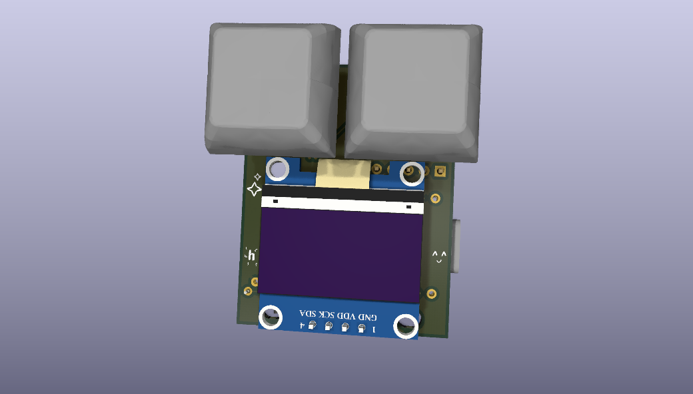
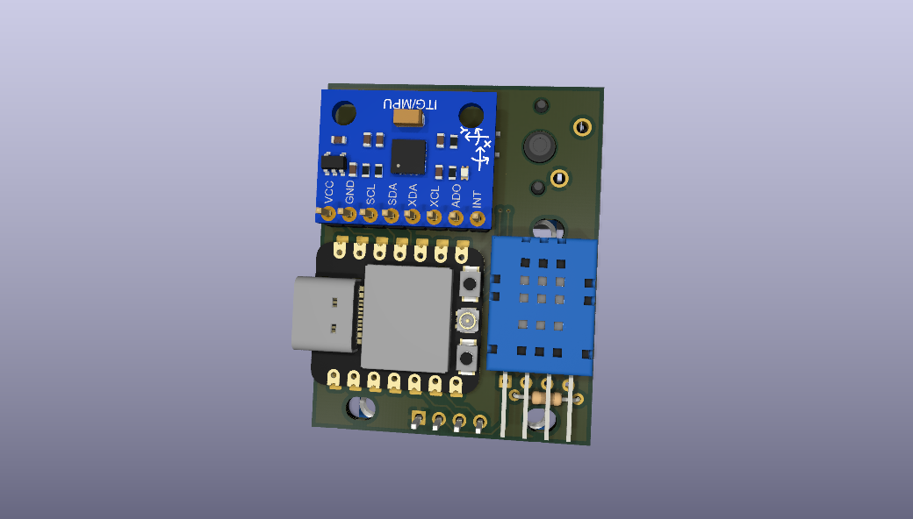
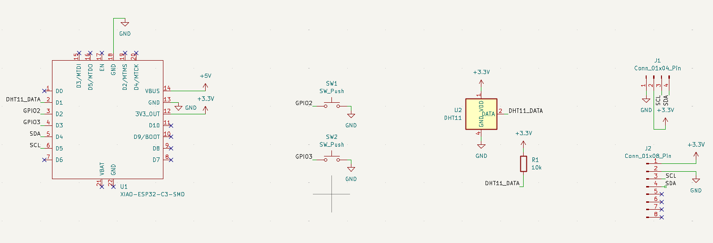
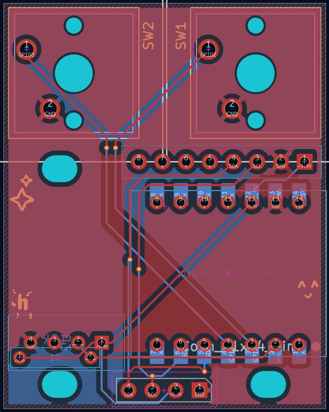
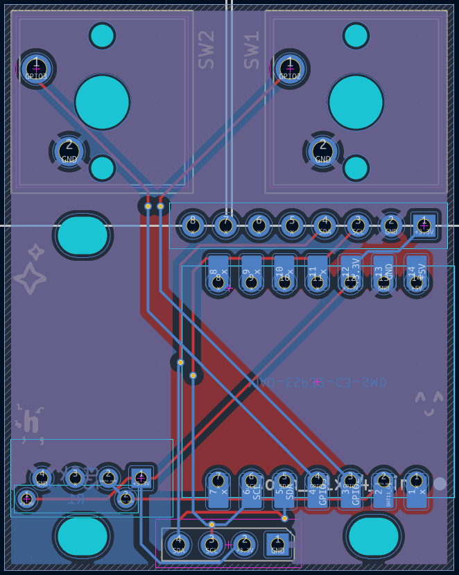

# Starbie
|||
|---|---|

Starbie is a tiny (4x4cm) device with two buttons, a gyro+accelerometer and temperature+humidity sensor. Alongside the controls, you can interact with it by physically moving the board.

# What it is
This project was created following the week 1 beginner [tutorial](https://github.com/SharKingStudios/Starbie) for [halflife](https://halflife.hackclub.com/)! I designed the schematic and PCB using [KiCad](https://www.kicad.org/), along with the footprints & symbols provided by the tutorial (for the parts such as the screen, gyro, ...). It can be reprogrammed at will, but comes with some stock firmware to show off the additional sensors connected to the ESP32C3 (such as the accelerometer). Since the microcontroller also has built-in features like 2.4GHz and BLE, I might update the firmware later down the line to take advantage of these features, for example to show which WiFi bands are congested and select the quietest one.

# Hardware
Schematic:

PCB:

|||
|---|---|

# Software
[`firmware/`](starbie/firmware/) contains one Arduino IDE sketch for the XIAO ESP32-C3 that shows the state of the gyro+accelerometer, temperature, humidity, and counts the number of times each button has been pressed. The steps to flash the firmware are as follows:
1. Open the firmware directory in the Arduino IDE and plug the Starbie into the computer via USB.
2. Make sure you have the correct board installed. You can do this by going to `Tools > Board > Boards Manager`, searching `esp32` and installing `esp32 by Espressif Systems`. Then select `Tools > Board > esp32 > XIAO_ESP32C3` and select your board's port under `Tools > Port` (it will probably be the only one).
3. Make sure you have all of the required libraries installed. You can do this by going to `Sketch > Include Library > Manage Libraries` and installing:
    -  Adafruit GFX Library
    -  Adafruit SSD1306
    -  Adafruit MPU6050
    -  DHT sensor library
  If you are prompted to install dependencies, select "Install all".
4. Press the upload button:
   
   

# Cost
This is a rough outline of the cost, see [`BOM.md`](bom.md) for more details.

| Part | Cost |
| --- | --- |
| [Keycaps](https://www.alibaba.com/product-detail/Multi-color-1U-M-OA-Profile_1601366568468.html) | $1.08 |
| [Key switches](https://www.alibaba.com/product-detail/GATERON-Grape-Smoothie-Switch-Full-POM_1601822163412.html) | $2.00 |
| [XIAO ESP32C3](https://www.alibaba.com/product-detail/Seeed-Studio-XIAO-ESP32-S3-C3_1601374328247.html) | $5.50 |
| [Screen](https://www.alibaba.com/product-detail/Stock-0-96-Inch-OLED-Module_1600917220368.html) | $1.17 |
| [Temperature & humidity sensor](https://www.alibaba.com/product-detail/Hot-Sell-Original-DHT-11-Digital_62344257902.html) | $0.54 |
| [Gyroscope & accelerometer](https://www.alibaba.com/product-detail/GY-521-MPU-6050-6-Axis_1601943975478.html) | $1.57 |
| [PCB](https://jlcpcb.com) | $4.00 |
| **Total + Shipping** | **$24.27** |
